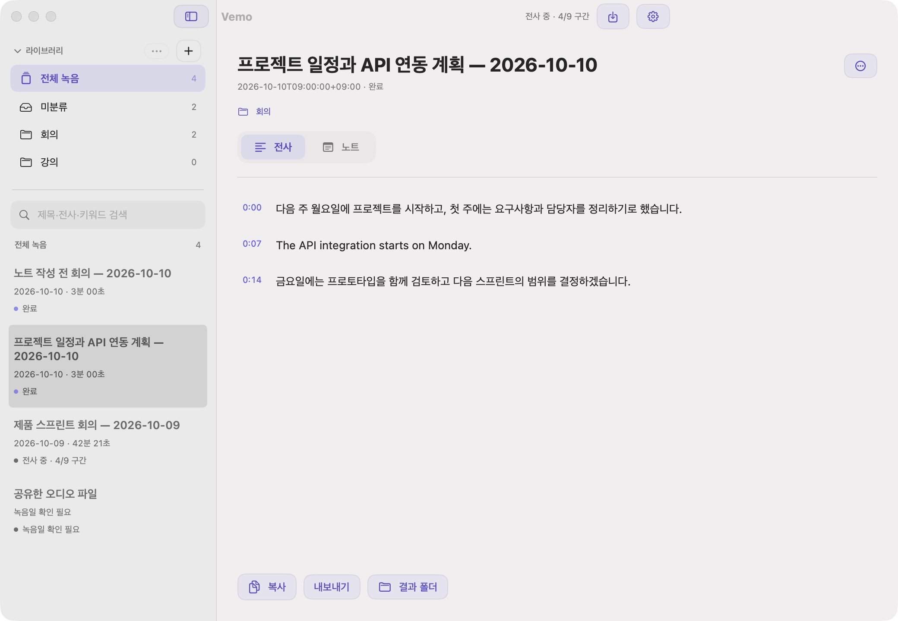
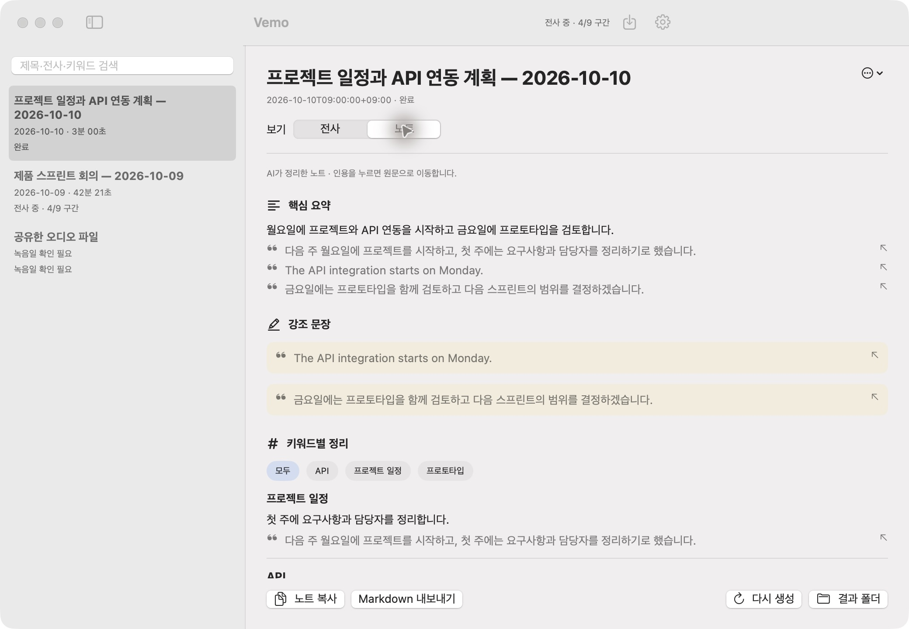
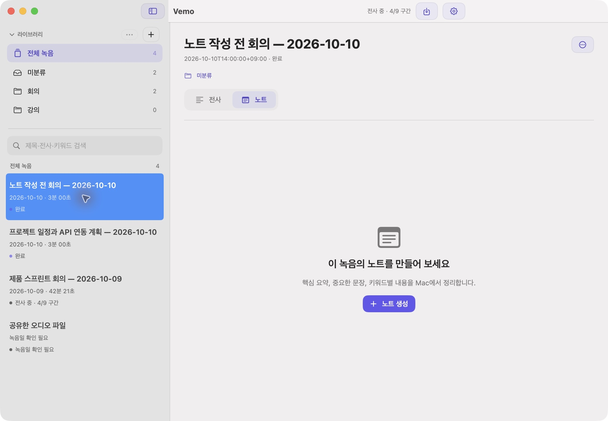
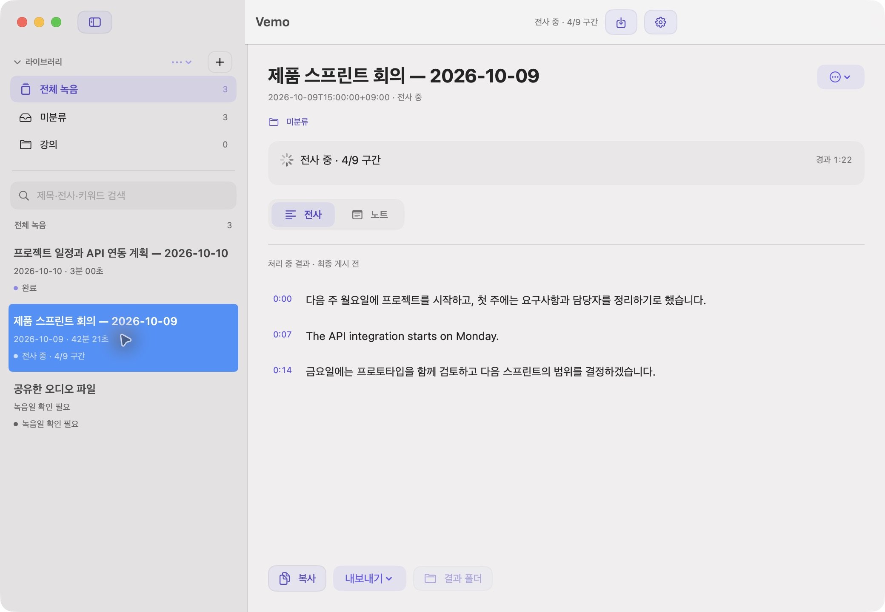
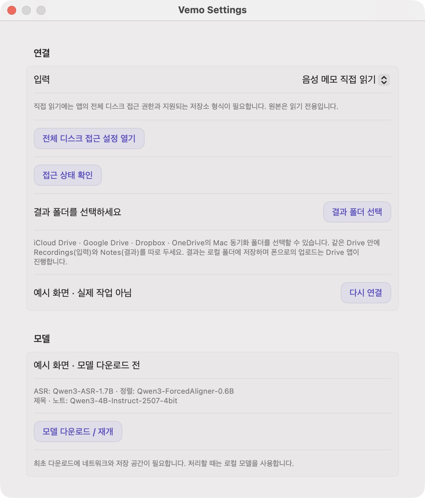
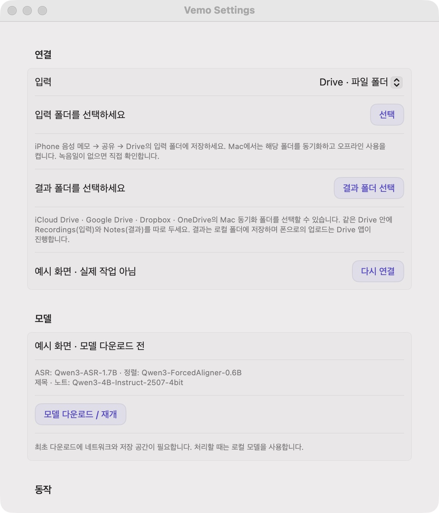
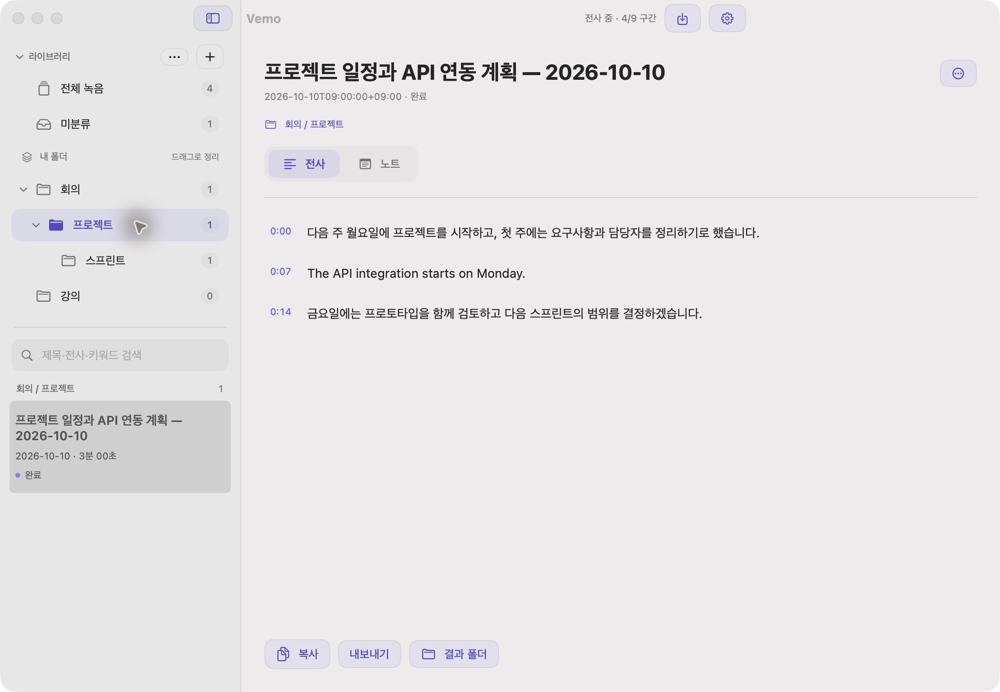

<p align="center"></p>

# Vemo

아이폰으로 녹음하고, Mac에서 읽기 좋은 전사문으로 만드세요.

Vemo는 Apple Silicon Mac에서 한국어 중심의 음성을 전사하는 로컬 앱입니다. 영어가 섞인 녹음도 처리하며, 문장·문단으로 정리한 전사문, **내용 기반 제목 + 녹음일**, **핵심 요약·강조 문장·키워드별 노트**를 제공합니다. iPhone에서는 기본 **음성 메모와 파일 앱**을 사용합니다.

> 0.2 프리뷰에 노트 정리, Drive 폴더 연결, 녹음 폴더 관리와 보라색 UI를 포함했습니다. preview.2에서는 버튼 클릭 영역과 일시 중지된 작업의 재개를 개선했습니다. preview.3에서는 칸 경계를 정리했습니다. preview.4에서는 하위 폴더를 제공합니다. preview.5는 현재 로컬 후보 빌드입니다. build 12 설치 후 사용자가 새 폴더 생성, 클릭·폴더 간 드래그와 스크롤 흰 배경 제거를 확인했고, 기존 접근 권한도 유지됐습니다. 상위 폴더 삭제는 하위 폴더도 함께 삭제하며 녹음·전사·노트는 보존합니다. build 13을 설치해 녹음 선택·내용 전환을 확인했고, 실패했던 노트 3건도 재생성·저장을 마쳤습니다. 현재 공개 다운로드는 preview.4입니다.

**[현재 공개 프리뷰 DMG 다운로드](https://github.com/SANGDNOG/Vemo/releases/tag/v0.2.0-preview.4)** · [설치 안내](docs/INSTALL.txt) · [라이선스](LICENSE)

> 현재 배포는 Developer ID 서명·Apple 공증이 없는 프리뷰입니다. macOS의 최초 실행 허용이 필요할 수 있습니다. 다른 실제 Mac에서의 검증은 아직 진행하지 않았습니다.

## 화면 예시

아래는 Vemo의 실제 UI에 가상의 녹음과 전사문을 넣은 예시입니다. 처리 진행률도 설명용 샘플이며 실제 녹음이나 측정 결과가 아닙니다.











## 준비물

- Apple Silicon Mac, macOS 26.2 이상. **메모리 16GB 이상 권장**. Intel Mac은 지원하지 않습니다.
- 모델 약 **8.8GB**와 앱·원본 작업 복사본·결과를 위한 추가 저장 공간.
- 최초 모델 다운로드를 위한 인터넷. 배포 앱에 Python과 오디오 변환기가 포함되어 Homebrew 설치가 필요 없습니다.
- 직접 음성 메모 연동을 쓰려면 동일 Apple 계정의 iCloud 음성 메모 동기화.

직접 읽기는 **macOS 27.0.1의 저장소 형식에서 확인**했습니다. 다른 OS나 변경된 저장소 형식에서는 파일 가져오기 또는 공유 폴더를 사용하세요. 최소 실행 버전은 모든 버전의 음성 메모 데이터베이스 지원을 뜻하지 않습니다.

## 설치와 첫 실행

1. [Releases](https://github.com/SANGDNOG/Vemo/releases)에서 `Vemo-0.2.0-preview.4-arm64.dmg`를 내려받습니다.
2. DMG를 열고 **Vemo.app → Applications**로 드래그합니다.
3. Vemo를 실행합니다. macOS가 차단하면 **시스템 설정 → 개인정보 보호 및 보안 → 차단된 Vemo의 ‘확인 없이 열기’**에서 실행을 허용합니다. 이후 표시되는 열기 확인도 승인합니다. Gatekeeper를 끌 필요는 없습니다.
4. **Vemo → 설정…**에서 **모델 다운로드 / 재개**를 누릅니다. 다운로드 완료 후 로컬에서 처리합니다.
5. **결과 폴더 선택**으로 저장 위치를 지정합니다. iCloud Drive 또는 Google Drive·Dropbox·OneDrive의 Mac 동기화 폴더를 선택할 수 있습니다. 해당 서비스가 동기화를 마치면 iPhone에서도 결과를 읽을 수 있습니다.

DMG와 함께 제공하는 `SHA256SUMS`로 다운로드 파일을 확인할 수 있습니다.

```sh
shasum -a 256 -c SHA256SUMS
```

## iPhone 음성 메모 연결

1. iPhone과 Mac에서 동일 Apple 계정으로 iCloud의 **음성 메모** 동기화를 켭니다.
2. Mac 기본 음성 메모 앱에서 녹음이 내려받아졌는지 확인하고 **음성 메모 앱을 종료**합니다. Vemo는 편집 충돌을 줄이기 위해 기본 앱이 열려 있으면 기다립니다.
3. 시스템 설정 → 개인정보 보호 및 보안 → **전체 디스크 접근**에서 설치한 **Vemo.app**을 추가하고 켭니다. Vemo를 완전히 종료한 뒤 다시 실행합니다.
4. Vemo 설정의 입력을 **음성 메모 직접 읽기**로 선택하고 **접근 상태 확인**을 누릅니다.

처음 발견한 과거 녹음은 자동으로 시작하지 않습니다. 녹음을 선택해 **전사**하거나 설정의 **과거 미처리 녹음 모두 전사…**를 사용하세요. 이후 새로 발견한 녹음은 다운로드가 끝나고 읽기 가능한 상태가 되면 자동으로 처리합니다. 최대 60초 간격으로 다시 확인합니다.

전체 디스크 접근은 사용자가 macOS에서 승인해야 합니다. 이 프리뷰는 ad-hoc 서명으로 배포되어 **업데이트 후 권한 재등록이 필요할 수 있습니다**. 안정적인 배포 업데이트에는 추후 Developer ID 서명과 공증이 필요합니다.

## 파일로 가져오기

직접 연동이 지원되지 않거나 권한을 주고 싶지 않으면 다음 방법을 사용하세요.

- iPhone 음성 메모에서 **공유 → 파일에 저장**으로 iCloud Drive의 폴더에 저장합니다. Vemo 설정에서 입력을 **공유한 파일 폴더**로 바꾸고 그 폴더를 선택하면 새 파일을 수집합니다.
- Mac에서 **파일 가져오기…** 또는 `⌘O`로 오디오 파일을 선택합니다.

파일에 신뢰할 수 있는 녹음일이 없으면 앱에서 **실제 녹음 시작일**을 입력합니다. 다운로드일·파일 수정일·전사일로 대체하지 않습니다. 파일 방식은 녹음마다 iPhone의 공유 동작이 필요합니다. 지원 코덱은 macOS AVFoundation에 따르며, 확인된 형식은 WAV, M4A 및 음성 메모의 QTA입니다.

## Google Drive 등 다른 Drive 연결

Mac에 해당 서비스의 공식 동기화 앱을 설치하고 로그인한 뒤, **Mac에 내려받은 실제 폴더**를 연결합니다. Vemo가 Drive 계정에 직접 로그인하거나 원격 API로 파일을 읽는 방식은 아닙니다.

1. 같은 Drive 안에 `Vemo/Recordings`(녹음 입력)와 `Vemo/Notes`(결과) 폴더를 만듭니다.
2. Finder에서 입력 폴더의 **오프라인 사용 가능 / 다운로드 유지**를 켭니다. 스트리밍 파일명만 보이는 상태에서는 다운로드를 기다립니다. Google Drive의 미러링 방식도 사용할 수 있습니다.
3. Vemo 설정에서 입력을 **Drive · 파일 폴더**로 선택하고 `Recordings`를 지정합니다. 결과 폴더는 `Notes`로 지정합니다.
4. iPhone 음성 메모 → **공유**에서 Drive 앱 또는 파일 앱을 통해 `Recordings`에 저장합니다.
5. Mac이 내려받은 녹음을 Vemo가 자동으로 수집합니다. 실제 녹음일이 파일에 없으면 앱에서 날짜를 확인해 주세요. 전사와 노트 파일은 지정한 `Notes` 폴더에 저장됩니다.



입력·결과 폴더는 서로 포함되지 않는 별도 폴더여야 합니다. 같은 파일을 다시 공유해도 내용 해시로 중복 가져오기를 방지합니다. 손상된 오디오 한 개 때문에 다른 파일의 수집이 멈추지 않습니다. 녹음은 선택한 입력 폴더 바로 아래에서 찾으며 하위 폴더를 재귀적으로 수집하지 않습니다. 심볼릭 링크와 일부 가상 마운트는 지원하지 않으므로 이 경우 실제 로컬 미러 폴더를 사용하세요.

Vemo의 저장 완료는 **Mac의 결과 폴더에 저장됐다는 뜻**입니다. iPhone으로의 업로드는 각 Drive 앱이 수행하며, 폰 도착은 그 앱에서 확인해야 합니다. iCloud의 기본 음성 메모 자동 연동과 달리 다른 Drive에는 녹음마다 iPhone에서 공유하는 단계가 필요합니다. 실제 Google Drive·Dropbox·OneDrive 계정의 업로드와 iPhone 도착까지 검증한 것은 아닙니다.

## 녹음과 전사본을 ZIP으로 저장

로컬 개발 버전에서는 **설정 → ZIP 내보내기 → 폴더 선택**으로 저장 위치를 지정합니다. Nextcloud, Google Drive 등의 Mac 동기화 폴더나 일반 로컬 폴더를 선택할 수 있으며, 이 설정은 기기별로 기억합니다. 전사·노트의 자동 결과 폴더와는 별도 설정입니다.

**완료된 녹음 ZIP 내보내기**를 누르면 완료 상태인 녹음 전체의 원본 오디오, TXT·Markdown 전사문, 시간 구간 JSON을 녹음별 폴더로 묶습니다. 진행 상태와 오류를 설정 화면에서 확인하고, 완료 후 **ZIP 파일 위치 보기**로 Finder에서 엽니다. 파일명 충돌 시 새 이름을 사용하며, 원본이 없으면 불완전한 ZIP을 저장하지 않습니다. 원본 QTA는 그대로 포함하므로 재생에는 해당 형식을 지원하는 앱이 필요합니다.

Vemo의 완료 표시는 로컬 ZIP 생성·검사 완료를 의미합니다. 서버 업로드는 선택한 클라우드의 동기화 앱이 진행합니다. 아직 공개 preview.4에는 이 설정이 포함되지 않습니다.

## 녹음을 폴더로 정리

왼쪽 라이브러리의 **+**로 폴더를 만듭니다. 폴더를 선택한 상태에서 **+**를 누르면 그 안에 하위 폴더를 만듭니다. 생성 화면의 **상위 폴더**에서 위치를 바꾸거나 **최상위**를 선택할 수도 있습니다. **전체 녹음**, **미분류**, 사용자 폴더에서 녹음을 나누어 볼 수 있습니다.

- **녹음을 폴더 위로 드래그**해 분류합니다. **미분류**로 드래그하면 분류를 해제합니다. 한 번에 녹음 한 개를 이동합니다.
- **폴더를 다른 폴더 위로 드래그**하면 하위 폴더와 함께 이동합니다. **폴더** 제목 영역에 놓으면 최상위로 돌아옵니다. 폴더의 표시 순서를 바꾸는 기능은 아닙니다.
- 녹음 상세 화면의 **… → 폴더로 이동**에서도 분류합니다. 녹음 목록의 우클릭 메뉴에서도 이동할 수 있습니다.
- 폴더 옆 화살표로 하위 폴더를 접거나 펼칩니다. 예: `회의 / 프로젝트 / 스프린트`.
- 폴더의 우클릭 메뉴 또는 라이브러리의 **… → 이름·상위 폴더 변경**에서 이름과 위치를 바꿉니다. 자기 자신이나 자기 하위 폴더 안으로 이동할 수 없습니다. 같은 상위 폴더 안에서는 이름이 중복되지 않으며, 다른 상위 폴더 아래에는 같은 이름을 쓸 수 있습니다.
- **선택한 폴더에 직접 넣은 녹음만** 목록과 개수에 표시됩니다. 하위 폴더의 녹음은 해당 하위 폴더를 선택해 봅니다. **전체 녹음**에서는 모두 볼 수 있습니다. 이동 메뉴에는 폴더의 전체 경로가 표시됩니다.
- 상위 폴더를 삭제하면 모든 하위 폴더도 함께 삭제합니다. 삭제창에서 포함된 하위 폴더 수를 확인할 수 있습니다. 그 안의 녹음은 미분류로 돌아가며 파일·전사문·노트는 보존됩니다.
- 검색은 현재 선택한 폴더 안의 제목·전사·키워드를 찾습니다. 라이브러리를 접어 녹음 목록 공간을 넓힐 수 있습니다.



폴더 분류는 이 Mac의 Vemo에 저장됩니다. 기존 분류 파일은 첫 변경 때 새 형식으로 전환되며, 이전 형식은 `native/library-v1-backup.json`에 보존됩니다. 이전 앱으로 돌아가면 새 하위 폴더 분류를 읽을 수 없으므로 전환 전 분류를 별도로 복구해야 합니다. Apple 음성 메모나 Drive 원본 파일을 옮기지 않으며 다른 Mac으로 폴더 분류가 자동 동기화되는 기능은 없습니다. 보라색은 선택과 주요 동작에만 사용하며, 짧은 버튼·탭 반응은 macOS의 **동작 줄이기** 설정을 따릅니다.

## 노트 읽기와 저장

전사가 끝나면 같은 로컬 모델로 노트를 자동 생성합니다. 녹음 상세 화면의 **노트**를 선택하세요.

- **핵심 요약**: 녹음의 중심 내용을 간결하게 정리합니다.
- **강조 문장**: 내용상 중요한 문장을 원문 그대로 보여 줍니다. 음량이나 억양으로 중요도를 판정하지 않습니다.
- **키워드별 정리**: 주제별 정리와 근거 인용을 묶습니다. 키워드를 누르면 해당 주제로 필터링합니다. 목록 검색에도 노트의 키워드와 내용이 포함됩니다.
- 인용을 누르면 **전사 원문으로 이동**해 해당 문장을 강조합니다. 정렬이 성공하고 인용의 위치가 명확할 때만 실제 재생 시각으로 이동합니다.
- **노트 복사 / 내보내기 → Markdown**로 읽기 좋은 파일을 저장합니다. 자동 결과 폴더에도 제목·녹음일이 포함된 별도 노트 Markdown과 JSON이 저장됩니다.
- 예전에 완료한 전사에는 **노트 생성**, 생성된 노트에는 **다시 생성**을 사용할 수 있습니다. 원문을 다시 전사할 필요는 없습니다.

AI 요약에는 오류가 있을 수 있습니다. 인용은 원문과 대조하며 원문에 없는 인용은 제외합니다. 인용이 일치해도 해석의 정확성을 보장하지는 않으므로 중요한 결정은 원문에서 확인하세요. 노트 생성 실패 시에도 성공한 전사문과 기존 노트는 보존되며 다시 시도할 수 있습니다.

## 전사문 읽기와 저장

- 준비 → 전사 → 시간 정렬 → 제목 생성 → 노트 정리 → 저장의 진행 상태와 완료 구간 수를 확인합니다.
- 단어별 정렬 결과를 **문장·문단**으로 묶어 읽습니다. 문장 시작 시각을 누르면 해당 위치로 이동해 재생합니다.
- 제목은 `프로젝트 일정과 API 연동 계획 — 2026-10-10`처럼 **녹음일**로 끝납니다. 제목을 수정하거나 다시 생성할 수 있습니다.
- 전사문을 복사하거나 **TXT, Markdown, SRT, VTT**로 내보냅니다. 시간 정렬에 실패해도 전사문은 보존하며, 정렬이 필요한 자막 기능은 제한됩니다.
- 결과 폴더 열기로 게시된 파일을 확인합니다. 새 결과는 별도 버전으로 저장해 기존 결과를 보존합니다.

기본값은 **전원 연결 시에만 처리**입니다. 창을 닫아도 메뉴 막대에서 실행하며, **종료**하면 엔진도 종료합니다. 로그인 실행은 설정에서 선택합니다.

일시 중지 상태에서는 녹음 상세 화면의 **처리 재개**를 누르면 대기 중인 작업들이 저장된 지점에서 이어집니다. **전사하기 · 처리 재개**, **노트 생성 · 처리 재개** 같은 수동 동작도 전체 처리를 재개한 뒤 선택한 작업을 요청합니다. 전원 정책은 유지하므로 배터리에서도 처리하려면 설정의 **전원 연결 시에만 처리**를 끄세요. 완료된 녹음은 다시 전사하지 않습니다.

## 로컬 처리와 현재 한계

전사는 **Qwen3-ASR-1.7B**, 시간 정렬은 **Qwen3-ForcedAligner-0.6B**, 제목과 노트는 **Qwen3-4B-Instruct-2507 4bit**를 사용합니다. 한국어 전사 프롬프트를 사용하며 영어를 번역하는 기능은 아닙니다. 모델 리비전과 패키지 버전은 고정합니다.

오디오·전사문·제목·노트는 Mac에서 처리합니다. 모델 다운로드는 Hugging Face에 접속하며, Drive 입력·출력을 선택하면 해당 제공자의 동기화가 사용됩니다. 별도 전사 서버나 API 키는 필요 없습니다. Apple 원본 저장소는 읽기만 하고 작업용 복사본으로 처리합니다.

이 프리뷰는 새 iPhone 녹음의 실시간 도착부터 파일 앱의 결과 표시까지 전체 흐름, 로그인·잠자기 복귀, 다른 실제 Mac에서의 실행을 아직 검증하지 않았습니다. 잡음·겹치는 발화·고유명사에는 오류가 있을 수 있고, 정답 전사 기준의 정확도 수치는 없습니다. 화자 분리 기능은 없습니다. 공개 배포 검증 범위는 [검증 기록](docs/VALIDATION.md)에 설명합니다.

## 데이터 위치와 제거

새 설치는 `~/Library/Application Support/Vemo/`에 모델과 작업을 저장합니다. 기존 개인용 앱의 `VoiceMemoTranscriber` 데이터가 있으면 절대 경로를 보존하기 위해 그 폴더를 그대로 재사용합니다.

앱에서 로그인 실행을 끄고 종료한 뒤 Vemo.app을 삭제합니다. 모델과 작업도 지우려면 해당 App Support 폴더를 별도로 삭제하세요. 지정한 결과 폴더와 Apple 원본 음성 메모는 별도입니다.

## 소스에서 빌드

개발에는 Apple Silicon, Python 3.12와 Swift 6/macOS SDK가 필요합니다. 런타임은 공식 python-build-standalone 아카이브의 체크섬을 확인하고 고정된 PyPI 패키지와 엔진 wheel로 구성합니다. 모델은 DMG에 포함하지 않습니다.

```sh
python3 scripts/build-runtime.py
bash scripts/build-app.sh
bash scripts/build-dmg.sh
```

기본 빌드는 ad-hoc 서명입니다. 개발용 고정 인증서는 `SIGNING_IDENTITY`로 지정할 수 있습니다. 인증서나 비밀 키는 저장소에 포함하지 마세요. 고정된 인증서로 서명하는 개인용 업데이트는 같은 bundle ID도 유지해야 합니다.

```sh
build/portable/python/bin/python3 -m unittest discover -s tests
swift run --package-path macos NativeChecks --broker-checks
python3 macos/Tests/SelectionChecks/run.py
python3 macos/Tests/ProcessingChecks/run.py --mutation-check
swift scripts/build-icon.swift assets
```

[JSONL 프로토콜](docs/protocol.md) · [아이콘 소스와 재생성](assets/README.md) · [외부 구성요소 고지](THIRD_PARTY_NOTICES.md)

Vemo의 코드와 직접 작성한 벡터 아이콘은 MIT 라이선스입니다. 포함된 Python 라이브러리와 별도로 내려받는 모델에는 각각의 라이선스가 적용됩니다.
