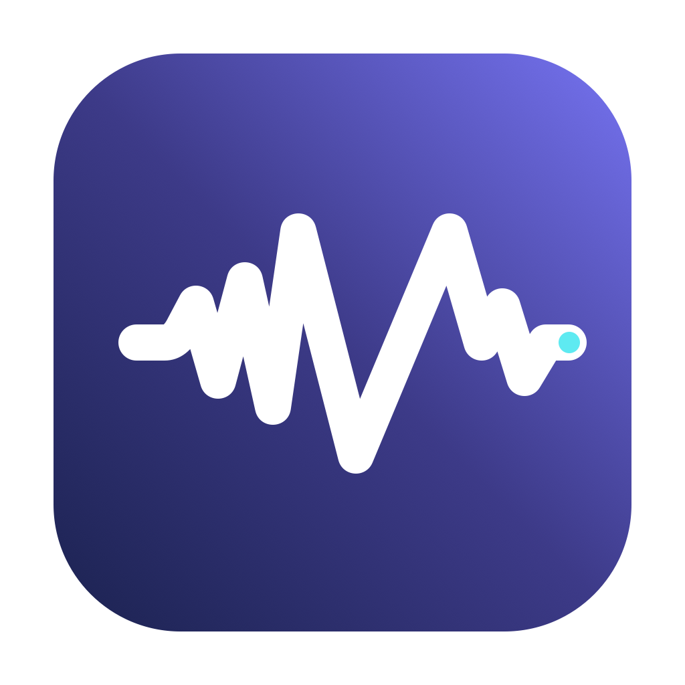
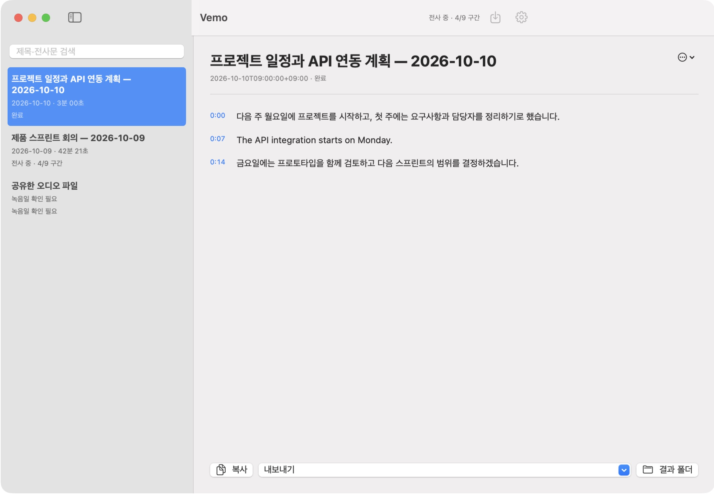
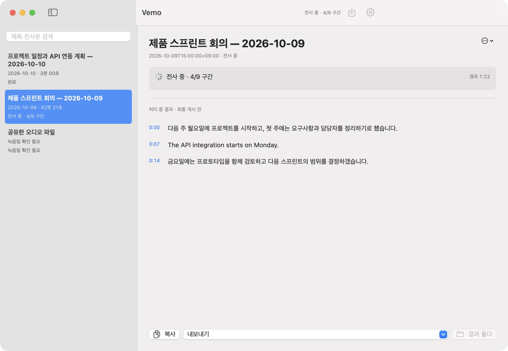
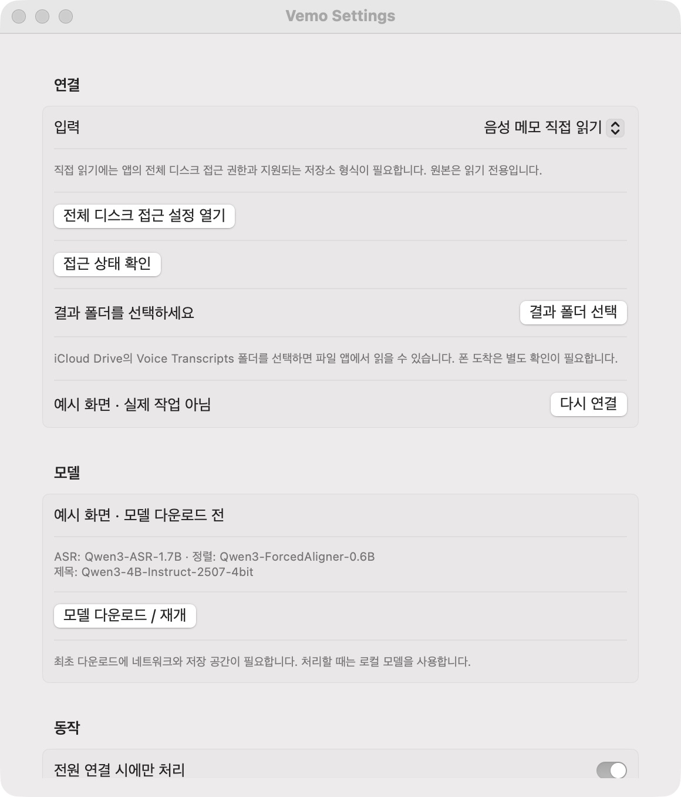

<p align="center"></p>

# Vemo

아이폰으로 녹음하고, Mac에서 읽기 좋은 전사문으로 만드세요.

Vemo는 Apple Silicon Mac에서 한국어 중심의 음성을 전사하는 로컬 앱입니다. 영어가 섞인 녹음도 처리하며, 문장·문단으로 정리한 전사문과 **내용 기반 제목 + 녹음일**을 제공합니다. iPhone에서는 기본 **음성 메모와 파일 앱**을 사용합니다.

**[프리뷰 DMG 다운로드](https://github.com/SANGDNOG/Vemo/releases/latest)** · [설치 안내](docs/INSTALL.txt) · [라이선스](LICENSE)

> 현재 배포는 Developer ID 서명·Apple 공증이 없는 프리뷰입니다. macOS의 최초 실행 허용이 필요할 수 있습니다. 다른 실제 Mac에서의 검증은 아직 진행하지 않았습니다.

## 화면 예시

아래는 Vemo의 실제 UI에 가상의 녹음과 전사문을 넣은 예시입니다. 처리 진행률도 설명용 샘플이며 실제 녹음이나 측정 결과가 아닙니다.







## 준비물

- Apple Silicon Mac, macOS 26.2 이상. **메모리 16GB 이상 권장**. Intel Mac은 지원하지 않습니다.
- 모델 약 **8.8GB**와 앱·원본 작업 복사본·결과를 위한 추가 저장 공간.
- 최초 모델 다운로드를 위한 인터넷. 배포 앱에 Python과 오디오 변환기가 포함되어 Homebrew 설치가 필요 없습니다.
- 직접 음성 메모 연동을 쓰려면 동일 Apple 계정의 iCloud 음성 메모 동기화.

직접 읽기는 **macOS 27.0.1의 저장소 형식에서 확인**했습니다. 다른 OS나 변경된 저장소 형식에서는 파일 가져오기 또는 공유 폴더를 사용하세요. 최소 실행 버전은 모든 버전의 음성 메모 데이터베이스 지원을 뜻하지 않습니다.

## 설치와 첫 실행

1. [Releases](https://github.com/SANGDNOG/Vemo/releases)에서 `Vemo-0.1.0-preview.1-arm64.dmg`를 내려받습니다.
2. DMG를 열고 **Vemo.app → Applications**로 드래그합니다.
3. Vemo를 실행합니다. macOS가 차단하면 **시스템 설정 → 개인정보 보호 및 보안 → 차단된 Vemo의 ‘확인 없이 열기’**에서 실행을 허용합니다. 이후 표시되는 열기 확인도 승인합니다. Gatekeeper를 끌 필요는 없습니다.
4. **Vemo → 설정…**에서 **모델 다운로드 / 재개**를 누릅니다. 다운로드 완료 후 로컬에서 처리합니다.
5. **결과 폴더 선택**으로 저장 위치를 지정합니다. iCloud Drive의 폴더를 선택하면 iPhone 파일 앱에서도 결과 파일을 읽을 수 있습니다.

DMG와 함께 제공하는 `SHA256SUMS`로 다운로드 파일을 확인할 수 있습니다.

```sh
shasum -a 256 -c SHA256SUMS
```

## iPhone 음성 메모 연결

1. iPhone과 Mac에서 동일 Apple 계정으로 iCloud의 **음성 메모** 동기화를 켭니다.
2. Mac 기본 음성 메모 앱에서 녹음이 내려받아졌는지 확인하고 **음성 메모 앱을 종료**합니다. Vemo는 편집 충돌을 줄이기 위해 기본 앱이 열려 있으면 기다립니다.
3. 시스템 설정 → 개인정보 보호 및 보안 → **전체 디스크 접근**에서 설치한 **Vemo.app**을 추가하고 켭니다. Vemo를 완전히 종료한 뒤 다시 실행합니다.
4. Vemo 설정의 입력을 **음성 메모 직접 읽기**로 선택하고 **접근 상태 확인**을 누릅니다.

처음 발견한 과거 녹음은 자동으로 시작하지 않습니다. 녹음을 선택해 **전사**하거나 설정의 **과거 미처리 녹음 모두 전사…**를 사용하세요. 이후 새로 발견한 녹음은 다운로드가 끝나고 읽기 가능한 상태가 되면 자동으로 처리합니다. 최대 60초 간격으로 다시 확인합니다.

전체 디스크 접근은 사용자가 macOS에서 승인해야 합니다. 이 프리뷰는 ad-hoc 서명으로 배포되어 **업데이트 후 권한 재등록이 필요할 수 있습니다**. 안정적인 배포 업데이트에는 추후 Developer ID 서명과 공증이 필요합니다.

## 파일로 가져오기

직접 연동이 지원되지 않거나 권한을 주고 싶지 않으면 다음 방법을 사용하세요.

- iPhone 음성 메모에서 **공유 → 파일에 저장**으로 iCloud Drive의 폴더에 저장합니다. Vemo 설정에서 입력을 **공유한 파일 폴더**로 바꾸고 그 폴더를 선택하면 새 파일을 수집합니다.
- Mac에서 **파일 가져오기…** 또는 `⌘O`로 오디오 파일을 선택합니다.

파일에 신뢰할 수 있는 녹음일이 없으면 앱에서 **실제 녹음 시작일**을 입력합니다. 다운로드일·파일 수정일·전사일로 대체하지 않습니다. 파일 방식은 녹음마다 iPhone의 공유 동작이 필요합니다. 지원 코덱은 macOS AVFoundation에 따르며, 확인된 형식은 WAV, M4A 및 음성 메모의 QTA입니다.

## 전사문 읽기와 저장

- 준비 → 전사 → 시간 정렬 → 제목 생성 → 저장의 진행 상태와 완료 구간 수를 확인합니다.
- 단어별 정렬 결과를 **문장·문단**으로 묶어 읽습니다. 문장 시작 시각을 누르면 해당 위치로 이동해 재생합니다.
- 제목은 `프로젝트 일정과 API 연동 계획 — 2026-10-10`처럼 **녹음일**로 끝납니다. 제목을 수정하거나 다시 생성할 수 있습니다.
- 전사문을 복사하거나 **TXT, Markdown, SRT, VTT**로 내보냅니다. 시간 정렬에 실패해도 전사문은 보존하며, 정렬이 필요한 자막 기능은 제한됩니다.
- 결과 폴더 열기로 게시된 파일을 확인합니다. 새 결과는 별도 버전으로 저장해 기존 결과를 보존합니다.

기본값은 **전원 연결 시에만 처리**입니다. 창을 닫아도 메뉴 막대에서 실행하며, **종료**하면 엔진도 종료합니다. 로그인 실행은 설정에서 선택합니다.

## 로컬 처리와 현재 한계

전사는 **Qwen3-ASR-1.7B**, 시간 정렬은 **Qwen3-ForcedAligner-0.6B**, 제목은 **Qwen3-4B-Instruct-2507 4bit**를 사용합니다. 한국어 전사 프롬프트를 사용하며 영어를 번역하는 기능은 아닙니다. 모델 리비전과 패키지 버전은 고정합니다.

오디오·전사문·제목은 Mac에서 처리합니다. 모델 다운로드는 Hugging Face에 접속하며, iCloud 입력·출력을 선택하면 Apple의 동기화가 사용됩니다. 별도 전사 서버나 API 키는 필요 없습니다. Apple 원본 저장소는 읽기만 하고 작업용 복사본으로 처리합니다.

이 프리뷰는 새 iPhone 녹음의 실시간 도착부터 파일 앱의 결과 표시까지 전체 흐름, 로그인·잠자기 복귀, 다른 실제 Mac에서의 실행을 아직 검증하지 않았습니다. 잡음·겹치는 발화·고유명사에는 오류가 있을 수 있고, 정답 전사 기준의 정확도 수치는 없습니다. 화자 분리 기능은 없습니다. 공개 배포 검증 범위는 [검증 기록](docs/VALIDATION.md)에 설명합니다.

## 데이터 위치와 제거

새 설치는 `~/Library/Application Support/Vemo/`에 모델과 작업을 저장합니다. 기존 개인용 앱의 `VoiceMemoTranscriber` 데이터가 있으면 절대 경로를 보존하기 위해 그 폴더를 그대로 재사용합니다.

앱에서 로그인 실행을 끄고 종료한 뒤 Vemo.app을 삭제합니다. 모델과 작업도 지우려면 해당 App Support 폴더를 별도로 삭제하세요. 지정한 결과 폴더와 Apple 원본 음성 메모는 별도입니다.

## 소스에서 빌드

개발에는 Apple Silicon, Python 3.12와 Swift 6/macOS SDK가 필요합니다. 런타임은 공식 python-build-standalone 아카이브의 체크섬을 확인하고 고정된 PyPI 패키지와 엔진 wheel로 구성합니다. 모델은 DMG에 포함하지 않습니다.

```sh
python3 scripts/build-runtime.py
bash scripts/build-app.sh
bash scripts/build-dmg.sh
```

기본 빌드는 ad-hoc 서명입니다. 개발용 고정 인증서는 `SIGNING_IDENTITY`로 지정할 수 있습니다. 인증서나 비밀 키는 저장소에 포함하지 마세요. 고정된 인증서로 서명하는 개인용 업데이트는 같은 bundle ID도 유지해야 합니다.

```sh
build/portable/python/bin/python3 -m unittest discover -s tests
swift run --package-path macos NativeChecks
swift scripts/build-icon.swift assets
```

[JSONL 프로토콜](docs/protocol.md) · [아이콘 소스와 재생성](assets/README.md) · [외부 구성요소 고지](THIRD_PARTY_NOTICES.md)

Vemo의 코드와 직접 작성한 벡터 아이콘은 MIT 라이선스입니다. 포함된 Python 라이브러리와 별도로 내려받는 모델에는 각각의 라이선스가 적용됩니다.
