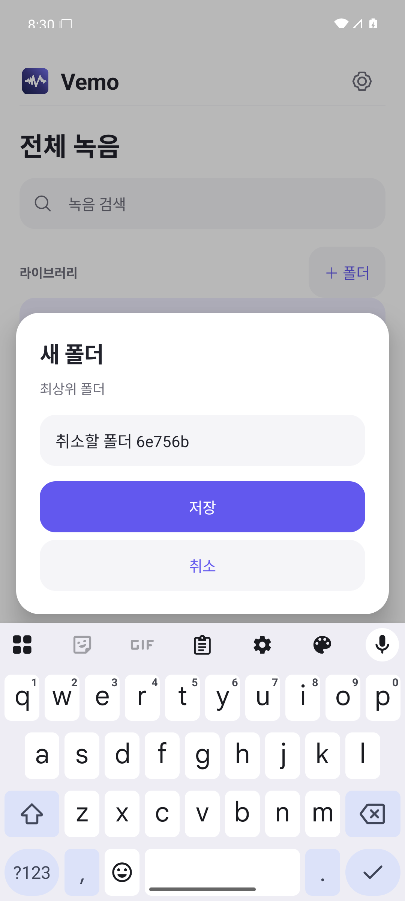
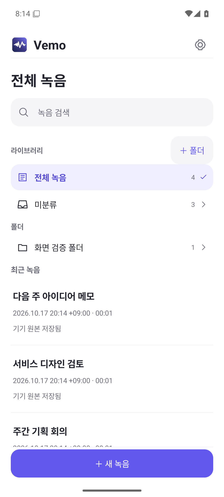

# Vemo Android 라이브러리·연결 프리뷰

현재 개발 중인 연결 기능의 설정과 검증 범위입니다. 공개 배포판의 기능 목록과 다릅니다. 기존 Mac 앱의 녹음·전사·노트와 ZIP은 유지합니다.

최신 실제 음성 처리와 Windows 검사는 [2026-10-18 기능 프리뷰 검증](FUNCTIONAL_PREVIEW.md)에 정리했습니다. 아래의 이전 합성 결과·UI 검사와 구분합니다.

## Android 0.1.1 라이브러리 화면

Android 앱은 폴더와 녹음 목록을 첫 화면으로 사용합니다. 화이트 배경에 Vemo Mac과 같은 보라색 포인트 컬러와 앱 아이콘을 적용하며, 설정은 상단 버튼에서 엽니다. 하단 녹음 버튼으로 새 녹음을 시작하고 녹음 중에도 라이브러리로 돌아갈 수 있습니다.

- 전체 녹음·미분류·폴더별 목록과 제목 검색
- 중첩 폴더 생성·이름 변경, 녹음의 폴더 이동
- 폴더 삭제 시 하위 폴더를 함께 정리하고 녹음은 미분류로 이동; 오디오 원본은 보존
- 녹음 상세의 재생·공유·폴더 복사와 전사·노트 탭
- 설정에서 녹음 모드·저장 폴더·PC 연결 관리

여기서 폴더는 **Android 앱 안의 분류**입니다. 파일 내보내기용 시스템 폴더와 구분되며, 이 버전에서는 분류 구조가 Mac이나 클라우드로 자동 동기화되지 않습니다. 기존 녹음은 처음에 미분류로 표시되고 원본 파일과 동기화 식별자는 유지됩니다.

이 변경은 Android용입니다. 설치된 Mac 앱을 교체하지 않습니다. 현재 통합 개발판에는 Google OAuth 연결도 포함합니다. 아래에서 디자인 단독 검사와 통합 검증의 범위를 구분합니다.

## Android 0.1.2 폴더 관리와 이동

폴더와 녹음 항목을 길게 누른 뒤 제자리에서 손을 떼면 관리 메뉴를 엽니다. 길게 누른 상태에서 움직이면 드래그를 시작하고, 대상 폴더 위에서 손을 떼면 이동합니다. 관리 메뉴의 이동 선택창도 사용할 수 있습니다.

- 생성·이름 변경·관리·이동·삭제 확인 창을 화이트 배경과 둥근 모서리로 통일합니다.
- 폴더 이동은 하위 폴더와 녹음 분류를 유지합니다. 자기 자신·하위 폴더·동일 이름이 있는 위치로의 이동은 거부합니다.
- 이동 취소나 폴더 밖에 놓기는 분류를 변경하지 않습니다. 원본 오디오와 기존 동기화 식별자는 유지합니다.



## 저장 방식

- **Mac:** Google OAuth 직접 연결을 추가하는 중입니다. 기존 Google Drive 데스크톱 앱·Nextcloud 로컬 동기화 폴더 선택도 유지합니다. Windows 기능 프리뷰는 [별도 안내](../windows/README.md)를 참고하세요.
- **Android:** 녹음은 앱 내부에 먼저 저장합니다. 기기 폴더를 선택해 복사하거나 공유 메뉴로 Drive 등 다른 앱에 보낼 수 있습니다. 기본 Drive 앱이 PC처럼 일반 동기화 폴더를 제공한다고 가정하지 않습니다.
- **Android 자동 왕복:** Nextcloud HTTPS WebDAV 또는 Google Drive OAuth 연결을 선택합니다. 실제 계정에서 합성 녹음·테스트 결과의 왕복을 확인했습니다. 실제 음성의 자동 AI 처리와 백그라운드 동작은 후속 검증입니다.
- 녹음만 모드는 파일 저장/업로드만 합니다. PC 자동 처리 모드는 지정한 PC가 전사·제목·상세 노트를 만들고 완료 결과를 폰에 돌려줍니다. 폰 자체 AI 처리 기능은 후속 단계입니다.

## Nextcloud 시험 연결

1. Nextcloud 데스크톱 앱에서 별도의 `Vemo 테스트` 폴더를 동기화하고 오프라인 사용을 켭니다.
2. Mac Vemo 설정의 **Android Vemo 연결 → 폴더 연결**에서 이 폴더를 고릅니다. 기존 일반 입력·결과·ZIP 폴더와 겹치지 않게 합니다. 이 PC를 처리기로 등록하는 `processor.json`이 생성됩니다.
3. Nextcloud 동기화 앱의 업로드가 완료된 다음 Android Vemo 설정에서 같은 서버·계정·폴더를 연결합니다. 서버 비밀번호 대신 계정에서 발급한 앱 비밀번호를 권장합니다. 비밀번호를 GitHub나 대화에 붙이지 마세요.
4. **PC 자동 처리**로 녹음하고 **완료**를 누릅니다. 일시정지만 한 녹음은 완료 파일로 전송되지 않습니다.
5. PC의 모델과 결과 폴더를 준비하고 처리를 켭니다. 전사와 노트가 완료되면 결과가 동기화 폴더에 저장되고, Nextcloud 업로드 후 폰에서 확인할 수 있습니다.

`로컬 폴더 저장 완료`는 서버 도착 확인과 다릅니다. PC가 꺼져 있거나 네트워크가 없으면 녹음은 보존되고 연결 후 처리를 계속합니다. 다른 PC가 이미 등록된 폴더는 자동으로 덮어쓰지 않습니다.

## Google OAuth 개발 프리뷰

현재 공개 DMG와 설치된 Mac build 23에는 이 기능이 없습니다. 소스 개발판을 대상으로 하며, 실제 계정 왕복을 검증하기 전에는 기존 녹음 대신 별도 테스트 폴더와 합성 녹음으로 확인합니다.

1. 같은 Google Cloud 프로젝트에서 Drive API를 켜고 OAuth 동의 화면을 설정합니다. 권한은 `https://www.googleapis.com/auth/drive.file`만 사용합니다.
2. Desktop 클라이언트를 만들고 생성 시 JSON을 저장합니다. Google이 보안 비밀번호를 가린 뒤에는 다시 다운로드할 수 없을 수 있습니다. 이 경우 같은 클라이언트에 새 보안 비밀번호를 추가하고 생성 화면에서 JSON을 저장합니다. 파일과 토큰을 저장소에 커밋하지 않습니다.
3. Android 클라이언트에는 `com.vemo.android`와 설치할 APK의 서명 인증서 SHA-1을 등록합니다. 다른 개발자의 debug 키나 release 서명은 별도 등록해야 합니다. 저장소에 개인 서명 키를 공유하지 않습니다.
4. 테스트 상태에서는 사용할 계정을 테스트 사용자에 등록합니다. Mac 개발판 설정의 **Google Drive → OAuth JSON 선택 → Google 연결**에서 브라우저 승인을 진행합니다. Mac은 전용 `Vemo 테스트` 폴더와 처리기 정보를 준비합니다.
5. Android 설정에서 Google Drive를 선택하고 같은 계정으로 승인합니다. Mac이 만든 전용 폴더를 선택한 뒤 완료 녹음을 동기화합니다.

`drive.file`은 앱이 만들거나 사용자가 앱에 허용한 파일에 대한 권한입니다. 임의의 기존 폴더를 선택했다고 그 안의 모든 파일에 대한 접근이 생기지는 않습니다. 같은 프로젝트의 두 클라이언트가 전용 파일을 공유할 수 있는지는 실계정 시험으로 확인해야 합니다.

Mac의 refresh token은 로컬 Keychain에, 가져온 JSON은 앱 전용 위치에 사용자 전용 권한으로 저장합니다. 연결 해제는 로컬 토큰만 삭제하며 Google 파일이나 계정의 앱 권한을 지우지 않습니다. 현재 Mac 프리뷰는 최초 계정·폴더 연결을 유지하고 다른 계정으로 자동 전환하지 않습니다. 테스트 상태의 OAuth 토큰 만료 등으로 재승인이 필요할 수 있습니다.

참고: [Google 네이티브 앱 OAuth](https://developers.google.com/identity/protocols/oauth2/native-app), [Drive 권한 범위](https://developers.google.com/workspace/drive/api/guides/api-specific-auth).

## 모델 선택

Mac 설정에서 전사와 노트 모델을 각각 선택하고 적용한 뒤 필요한 모델을 명시적으로 다운로드합니다. 기존 설치 모델과 완료 결과는 보존합니다. 진행 중인 작업이나 다운로드가 있을 때는 선택 변경이 제한될 수 있습니다.

현재 전사는 기존 1.7B와 실험적 0.6B를 선택할 수 있습니다. 0.6B는 모델 revision과 파일 메타데이터만 확인했으며 실제 추론 품질은 미검증입니다. 노트는 기존 27B만 사용할 수 있습니다. 시험한 4B는 JSON 형식과 계산·근거 정확도 검사에 실패하여 선택과 추천을 막았습니다. 32GB 미만 기기에는 검증된 노트 모델 추천이 아직 없습니다.

추천은 현재 메모리 용량에 따른 추정입니다. 작은 모델은 더 가볍지만 동일한 한국어 품질을 보장하지 않습니다. 새 선택지의 실제 추론과 품질 검증 상태는 앱에 표시합니다. 실행 중에는 모델을 자동으로 다운로드하지 않습니다.

## 폴더와 ZIP

동기화 폴더에는 녹음 UUID와 오디오 SHA256으로 구분한 파일 및 연결 JSON이 있습니다. 이 정보는 중복·부분 업로드·잘못된 결과 연결을 막기 위한 것입니다. 사용자가 내보내는 ZIP과는 별도입니다. 기존 ZIP은 녹음별로 원본 오디오, `transcript.txt`, `notes.md` 3개 파일만 담으며 Vemo의 폴더 경로를 따릅니다.

## 아직 남은 검증

Android 최신 안정 API 에뮬레이터를 사용합니다. Galaxy S22 Ultra의 마이크, 백그라운드 배터리 정책, 실제 Nextcloud 계정 왕복, Google Drive를 통한 실제 음성의 자동 처리, Windows native 앱, Android 로컬 AI는 각각 별도 검증이 필요합니다. APK 빌드·단위 검사 성공만으로 이러한 기능이 검증됐다고 판단하지 않습니다.

## Android 프리뷰 빌드와 설치

JDK 21, Android SDK Platform 36 / Build Tools 36.0.0이 필요합니다. 저장소 루트에서 다음을 실행합니다.

```sh
cd android
./gradlew assembleDebug testDebugUnitTest lintDebug
adb install -r app/build/outputs/apk/debug/app-debug.apk
```

개발용 debug APK이며 Play Store 배포판이 아닙니다. Android 8(API 26) 이상을 대상으로 하지만 현재 직접 실행한 환경은 API 36 에뮬레이터입니다. 첫 화면은 라이브러리입니다. 하단 새 녹음에서 마이크 권한을 허용하고, 녹음 → 일시정지 → 계속 → 완료 순서로 확인하세요. 폴더 복사와 공유는 완료한 녹음에서 사용합니다. SAF 복사는 원본과 구분하는 UUID·해시 파일명을 사용하며 사용자용 ZIP 이름과는 다릅니다.



Google Drive의 수동 전달도 유지합니다. Android 공유 메뉴로 Drive에 녹음을 보내고 Mac의 **Drive · 파일 폴더**로 가져오는 방식은 OAuth 등록이 필요하지 않으며, 처리 결과를 Android 앱으로 자동 반환하지는 않습니다.

## 폴더 관리·이동 프리뷰(0.1.2)의 검증

- 버전 `0.1.2`(versionCode `3`), debug APK 서명 v2 검증 통과.
- 단위 테스트 33개 통과. 폴더 이동의 하위 구조·분류 유지, 순환·이름 충돌 거부, 손상된 메타데이터 보존 검사를 포함합니다.
- API 36 에뮬레이터의 전체 instrumentation 10개 통과(145.772초). 실제 터치로 폴더·녹음 드래그, 취소·잘못된 대상, 가장자리 자동 스크롤, 길게 누르기와 접근성 long-click, 둥근 창의 생성·관리·회전, 기존 녹음·검색·재생·공유 회귀를 검사했습니다.
- 최초 실행은 9/10 통과였습니다. 관성 스크롤 중 고정 좌표 사용과 자동 스크롤 중 오래된 대상 좌표 사용, 테스트 시작 시 Application 초기화 대기를 보정한 뒤 전체 10/10을 확인했습니다.
- lint 오류 0개·경고 5개. 이전 경고 4개와 코드에서만 생성하는 `LibraryDragScroll`의 레이아웃 도구용 생성자 경고 1개가 남습니다.
- 사용자 확인용 에뮬레이터에 기존 데이터 유지 업데이트를 적용했고, 설치 전후 앱 파일 5개의 SHA256이 동일했습니다. 실제 기기와 수동 TalkBack 사용성은 미검증입니다.
- APK SHA256: `24d7c8ffc87a6f09704838c0237a8ec068375e1813752228cae8ed52d34c4728`.

## 라이브러리 프리뷰(0.1.1)의 검증

- 버전 `0.1.1`(versionCode `2`), package `com.vemo.android`, debug 서명 APK. APK 서명 v2 검증 통과.
- Android APK 빌드 및 단위 검사 29개 통과(기존 19개 + 폴더 6개 + 독립 경계 검사 4개). 2,000단계 폴더와 손상·초과 크기 메타데이터 보존 검사를 포함합니다.
- lint 오류 0개·경고 4개. 남은 경고는 기존 저장 공간 계산 2개, 설정 문구 번역 리소스 1개, 단색 테마 런처 아이콘 미제공 1개입니다. 기본 런처 및 앱 내 아이콘은 Mac 원본과 동일합니다.
- API 36 전용 에뮬레이터에서 instrumentation 6개 통과: 폴더 생성·이름 변경·이동·삭제와 원본 보존, 검색 커서·포커스 유지와 재생성, 전사·노트 탭, 실제 Back 제스처, 녹음·일시정지·재개·완료·재생, 잘못된 폴더 지정에도 녹음 지속, 읽기 전용 공유.
- 가로 화면 상단을 압축한 마지막 변경 후 검색·상세·화면 재생성 검사를 1회 재실행하여 통과했습니다. 360dp 세로·글씨 1.3배·가로 분할 화면의 실제 캡처를 확인했습니다. 화면 예시의 제목과 결과는 테스트용 합성 데이터입니다.
- 폴더 삭제 시 오디오·`local.json`·동기화 marker 바이트 보존을 검사했습니다. 폴더 저장소는 버전 1의 독립 `library.json`입니다.

## 녹음·모델 선택 단계의 검증 (OAuth 추가 전)

- Mac 소스 빌드 성공. 기존 native broker 검사 723항목, 자동 처리 coordinator 61항목 통과. 모바일 broker는 10개 합성 사례를 별도 assertion runner로 실행했습니다. 현재 Command Line Tools 환경에는 XCTest가 없어 `swift test` 성공으로 표시하지 않습니다.
- Python 3.12 전체 단위·회귀 검사 199개 통과(181.424초). 모델 자체 정확도 평가는 이 숫자에 포함되지 않습니다.
- Android 최종 APK 빌드 및 단위 검사 19개 통과, lint 오류 0개·경고 3개.
- API 36 에뮬레이터에서 녹음·일시정지·재개·완료·다시 열기·읽기 전용 공유 smoke test 통과.
- 실제 Kotlin marker → Swift broker → Python import → Swift result → Kotlin result를 가상 파일로 연결해 날짜, 내용, 중복 재실행 및 휴지통 영구 삭제 후 재수집 방지를 확인했습니다. 클라우드 서버 통신 검증과는 구분합니다.
- 이번 작업으로 설치된 Mac build 23이나 공개 DMG를 교체하지 않았습니다.

## Google OAuth 추가 검증 (2026-10-17)

- Desktop·Android OAuth 클라이언트를 같은 테스트 프로젝트에 등록했습니다. Mac의 브라우저 승인은 사용자가 직접 완료했으며, 전용 원격 root와 처리기 메타데이터를 준비했습니다. 고정 서명한 검증 앱을 재실행하여 기존 연결 복원과 빈 폴더 동기화를 확인했습니다. 실제 Android↔Mac 왕복 완료와는 구분합니다.
- OAuth 합성 검사 43개, Drive 합성 검사 15개, 연결 coordinator 합성 검사 36개, Android 단위 검사 36개 통과. Android lint 오류 0개·경고 18개이며 debug APK 빌드에 성공했습니다.
- 동기화 중 삭제·다시 전사·노트 변경이 발생하면 업로드 직전에 현재 작업을 다시 확인합니다. 독립 수명주기 검사 8개와 Android 취소 검사 2개를 통과했습니다. 이미 서버에 전송된 요청을 사후 취소하거나 원격 파일을 삭제하지는 않습니다.
- 실제 OkHttp HTTPS 스트리밍을 localhost에서 지연시켜 취소를 검사했습니다. 이 검사는 Google 실서버 로그인 검증과 별개입니다.
- Mac 내부 Google 캐시가 기존 폴더 겹침 검사에 걸리는 오류를 재현하고 수정했습니다. Google 전용 캐시의 정해진 경로만 허용하며, 일반 입력·출력 폴더의 겹침과 심볼릭 링크는 계속 차단합니다.
- 가상 Drive 서버에서 Kotlin 녹음 업로드 → Swift 가져오기 → 합성 전사·노트 결과 게시 → Kotlin 결과 수신을 확인했습니다. AI 추론 품질·실제 클라우드 권한 공유 성공을 뜻하지 않습니다.

## Google 실서버 왕복·UI 통합 검증 (2026-10-17)

- 사용자가 Android OAuth 승인을 마치고 Mac과 같은 테스트 폴더를 선택했습니다. 계정·폴더·처리기 일치를 확인했습니다.
- 실제 Google 업로드 주소의 선택적 `session_crd` 항목 때문에 업로드가 거부되는 오류를 수정했습니다. 단일 값의 길이·문자를 제한하고, 고정 도메인·경로 및 중복/알 수 없는 매개변수 차단은 유지합니다. 독립 경계 검사 41개를 통과했습니다.
- production 업로드 경로로 합성 AAC를 전송하고, 격리한 Mac 도구에서 production 가져오기·게시 경로로 테스트 전사·노트를 반환했습니다. 통합 Android APK가 결과를 검증·저장하고 녹음일·원본 AAC 해시/크기·메타데이터 보존을 확인했습니다. 실제 음성 인식이나 AI 추론 검증은 아닙니다.
- Mac의 첫 결과 게시 시도는 일반 오류로 끝났습니다. 같은 식별자로 단계 진단을 추가해 재시도하여 원격 바이트 재검증까지 성공했습니다. 첫 오류의 원인은 미확인이며 Mac production 수정으로 설명하지 않습니다.
- 통합 단위 검사 51개와 debug 앱·테스트 APK 빌드가 통과했습니다. lint 오류는 0개, 경고는 20개입니다. 위 디자인 단독 UI 검사와 이번 통합판 API 왕복 검증은 별도입니다.
- 전용 OAuth 에뮬레이터만 데이터 유지 방식으로 업데이트했습니다. 원본 디자인 작업 폴더·다른 에뮬레이터·설치된 Mac build 23·공개 DMG는 보존했습니다. 통합판 수동 UI, 실제 음성의 자동 처리·백그라운드 동기화, Galaxy 실기기, Windows·폰 자체 AI는 별도 검증이 필요합니다.


## Galaxy와 Mac 연결 — build 27 준비

[Galaxy↔Mac Google Drive 설정 안내](GALAXY_MAC_GOOGLE.md)를 참고하세요. 자동 왕복은 Mac Google 직접 연결을 우선하며, 일반 동기화 폴더/ZIP 위치와 구분합니다. 설치된 앱·이전 검증·남은 실계정 확인 범위를 안내에 명시했습니다.
